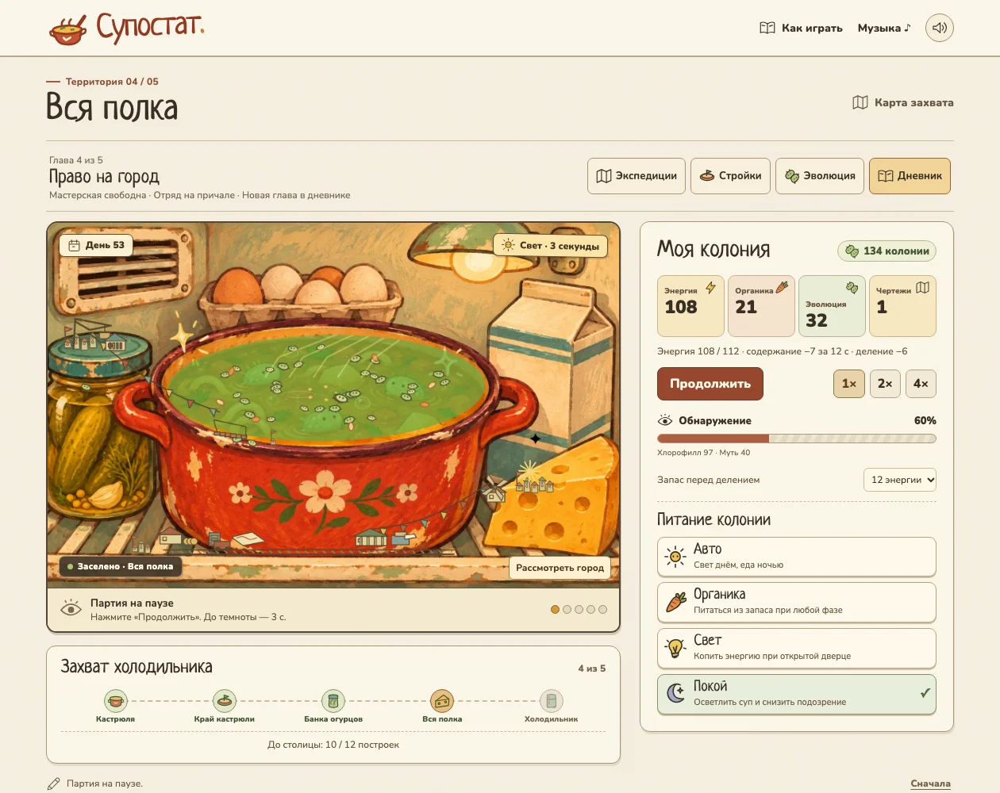
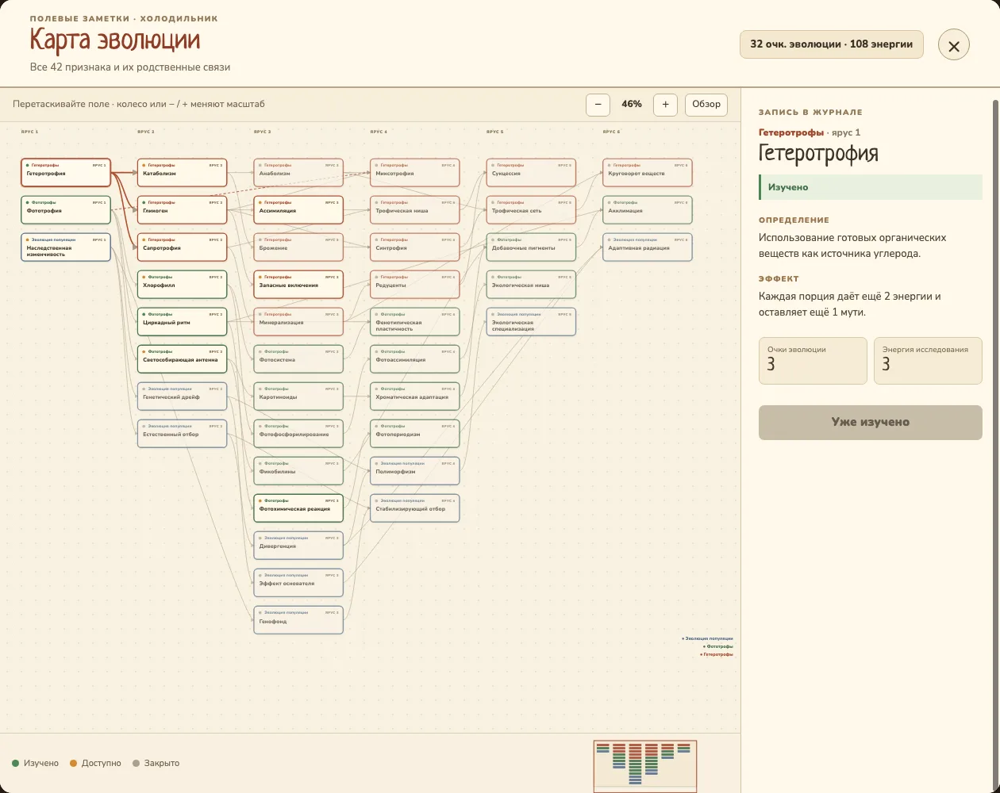
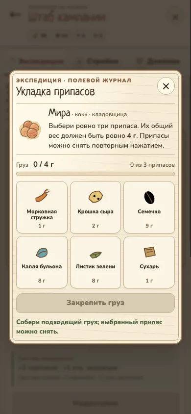

<div align="center">

# Супостат

**Стратегия в реальном времени о маленьком городе в забытой кастрюле.**

[Скачать игру](https://github.com/efrom-K/soupostat/releases/latest) · [Правила кампании](docs/DESIGN.md) · [Разработка](AGENTS.md)

</div>



На крышке записка: «В воскресенье разобрать холодильник». Пока человек видит вчерашний суп, картограф Лада прокладывает дорогу к огуречной банке. Начните с четырёх колоний, постройте порт и мельницу и решите, какой флаг поднять над полкой.

## Играть

| Устройство | Что скачать из [релиза 3.0.1](https://github.com/efrom-K/soupostat/releases/tag/v3.0.1) | Как запустить |
| --- | --- | --- |
| Mac с Apple Silicon | [Soupostat-macOS-arm64.zip](https://github.com/efrom-K/soupostat/releases/download/v3.0.1/Soupostat-macOS-arm64.zip) | Распаковать и открыть «Супостат.app». macOS 13+, локальная подпись |
| Windows x64 | [Soupostat-Windows-x64.zip](https://github.com/efrom-K/soupostat/releases/download/v3.0.1/Soupostat-Windows-x64.zip) | Распаковать всю папку и открыть `Soupostat.exe`. Использует Edge или системный браузер |
| Android | [Soupostat-android.apk](https://github.com/efrom-K/soupostat/releases/download/v3.0.1/Soupostat-android.apk) | Установить APK с локальной отладочной подписью. Для интерфейса нужен современный Android System WebView |
| Браузер и iOS | [Soupostat-web.zip](https://github.com/efrom-K/soupostat/releases/download/v3.0.1/Soupostat-web.zip) | На компьютере открыть `index.html`. Для Safari на телефоне разместить содержимое на статическом HTTPS-сервере |

Внутри сборок уже есть графика, шрифты и музыка. Партия сохраняется на устройстве. При обновлении клиент переносит прежнюю колонию и оставляет исходное сохранение. У каждой платформы отдельный прогресс.

## Первый день

1. **Включите часы.** Лампа горит 20 из 60 игровых секунд. При свете фототрофы накапливают энергию и окрашивают суп. В темноте колония ест органику в автоматическом режиме.
2. **Оставьте запас на дела.** Деление и содержание расходуют энергию автоматически. Резерв в 12 или 24 единицы защищает накопления от деления. Мастерская, экспедиции и исследования используют эти накопления.
3. **Отправьте разведчиков.** Чертежи нужны для строительства. По дороге можно соединить маршрут из плиток. В караване вы подбираете груз по весу, на посту дозорных повторяете позывной. Заберите груз по возвращении.
4. **Следите за человеком.** Муть и зелёный пигмент повышают подозрение. Покой помогает пережить осмотр. При обнаружении на 100% суп отправится в унитаз.

Жители сами появляются у края экрана. Вибрион Лада замечает новые берега, кокк Мира пересчитывает запасы, а бактериофаг Тим предупреждает об осмотре. Реплика исчезает сама, пока идут часы. При включённом звуке реплики в игре озвучиваются, если браузеру доступен локальный русский голос.

## Что меняется за кампанию

На ободке появляется пристань, на огуречной банке работает подъёмник, у сыра крутится мельница, а по полке ходит вагонетка. Двенадцать проектов ведут через пять сюжетных глав. Советы дают выбор между ресурсами и доверием соседей. В финале игрок принимает устав города. Сжатие времени доступно на 2× и 4×.



На единой карте — **42 признака** гетеротрофов, фототрофов и популяции. Для исследования нужны и очки эволюции, и энергия. Нажмите на узел, чтобы увидеть его эффект и подсветить связи.

<p align="center"></p>

## Запуск из исходников

Для веб-клиента достаточно современного браузера. Из корня проекта:

```sh
python3 -m http.server 8080 --bind 127.0.0.1 --directory game
node tests/engine.cjs
```

Откройте `http://localhost:8080`. Сервер нужен для проверки офлайн-кэша браузера. Сборки появляются в `dist/`.

| Сборка | Команда | Инструменты |
| --- | --- | --- |
| macOS | `./macos/build.sh` | Xcode Command Line Tools |
| Windows x64 | `./windows/build.sh` | .NET 10 SDK и пакет выполнения win-x64 |
| Android APK | `./android/build.sh` | JDK, Android SDK Platform 35 и Build Tools 36.0.0, переменная `ANDROID_HOME` |

Код проекта распространяется по [лицензии MIT](LICENSE). Для встроенных шрифтов действуют отдельные лицензии SIL Open Font License: [Neucha](game/assets/fonts/neucha-license.txt) и [Nunito](game/assets/fonts/nunito-license.txt).
